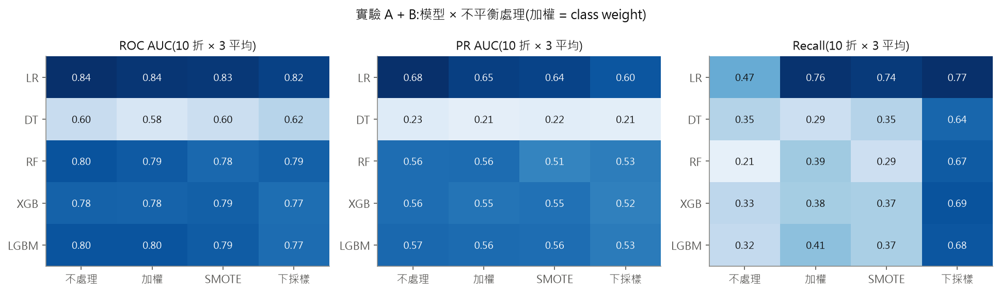
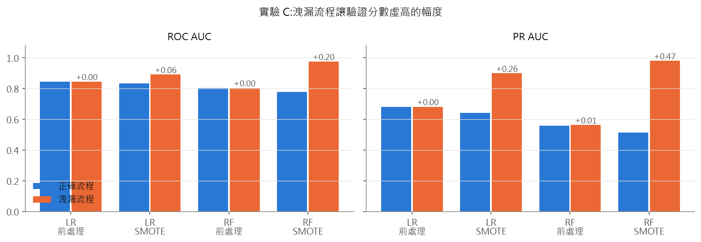
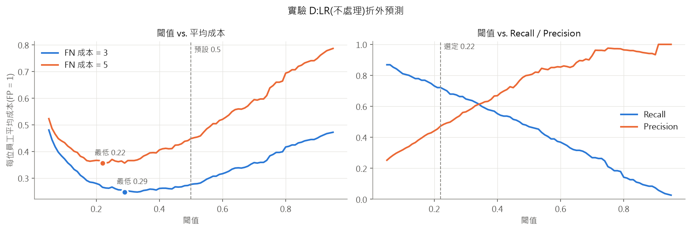
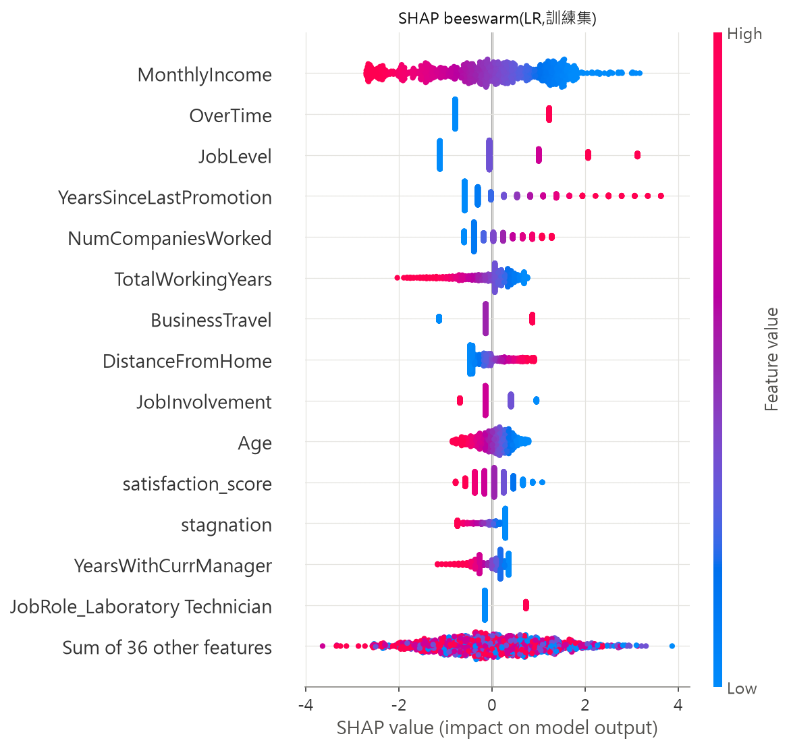
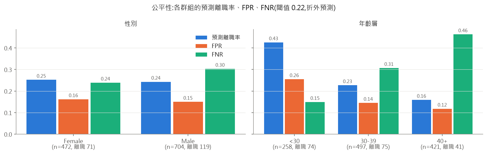
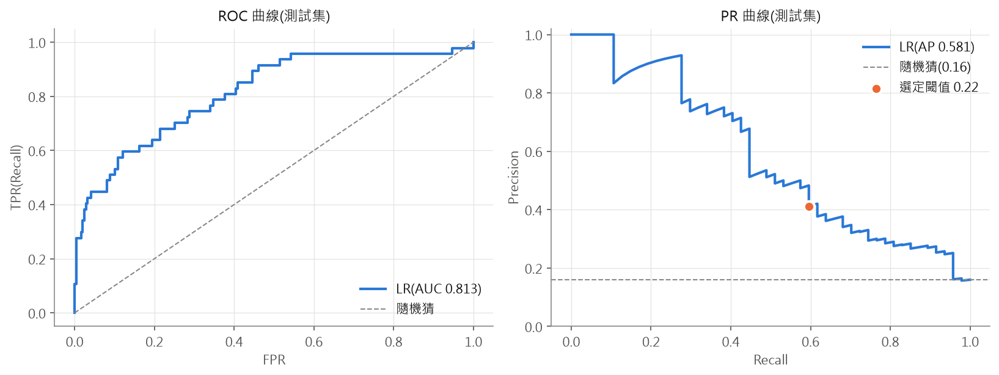

# 期末專題報告:員工離職預測

> 最後更新:2026-11-17。實驗程式在 `src/experiments.ipynb`,前處理在 `src/preprocessing.py`,
> 所有數字都可以在 `reports/*.csv` 找到,圖在 `reports/figures/`。

## 1. 簡介

### 1.1 研究動機
員工離職可能造成企業招募與培訓成本增加、組織知識流失，以及團隊工作效率下降。
若能透過機器學習提早辨識具有較高離職風險的員工，企業便能依據預測結果評估是否採取適當的留才措施,降低不必要的人力資源支出。
本專題將員工離職預測視為表格型二元分類問題，以 `Attrition` 作為預測目標，分為離職(Yes)與留任(No)。
由於資料集中離職員工約占 16.1%，存在類別不平衡問題，因此除了比較不同分類模型的預測能力，也需要探討不平衡處理方式對模型表現的影響。
此外，員工離職預測涉及實際的人力資源決策，因此模型不應只追求預測分數，也需要考慮模型可解釋性、不同人口群體間的預測差異，以及錯誤預測所產生的成本。

### 1.2 研究問題
1. **預測能力**:在中度不平衡的資料上，哪一類模型與哪一種不平衡處理方式(class weight、SMOTE、下採樣)的預測效果最好?
2. **可解釋性**:哪些特徵對離職預測最重要?模型的判斷是否符合 HR 直覺(例如加班頻率高、薪資滿意度低者離職率較高)?
3. **公平性**:模型對不同性別、年齡層的預測結果是否存在系統性差異?
4. **決策成本**:「誤判留任」與「誤判離職」的成本不對等時，最佳決策閾值為何?
5. **方法嚴謹性**:資料洩漏會讓驗證分數虛高多少?

### 1.3 背景知識
- **類別不平衡與評估指標**:離職約占 16.1%,若全部預測留任，Accuracy 可達約 84% 但完全抓不到離職者,所以以 ROC AUC 為主要指標，搭配 PR AUC 與離職類的 Recall / Precision / F1。PR AUC 對少數類更敏感。
- **不平衡處理方法**:class weight(調整損失權重)、SMOTE(合成少數類樣本)、下採樣(減少多數類樣本)，以及事後調整決策閾值。
- **資料洩漏(data leakage)**:任何需要從資料「學習」的轉換(編碼、標準化、填補、重抽樣、群組平均)若在切分前用全資料計算，驗證集資訊會洩漏進訓練，導致分數虛高。解法是把轉換包進 Pipeline，只在訓練折內擬合。
- **模型**:Logistic Regression(可解釋基準)、Decision Tree(易視覺化)、Random Forest(對小資料穩定)、XGBoost / LightGBM(梯度提升)。
- **可解釋性**:Permutation Importance 衡量整體重要性;SHAP 提供整體(Beeswarm)與單一員工(Waterfall)層級的特徵貢獻。
- **公平性指標**:比較各群體的預測離職率、False Positive Rate(FPR)與 False Negative Rate(FNR)，檢視是否有系統性偏差。
- **成本敏感決策**:FN(實際離職但預測留任)的成本高於 FP，依成本比例選擇期望成本最低的閾值，而不是固定用 0.5。

### 1.4 專案目標
1. 比較 Logistic Regression、Decision Tree、Random Forest、XGBoost、LightGBM 的預測表現，以 PR AUC 與 Recall 為重點。
2. 比較不處理、class weight、SMOTE、下採樣四種不平衡處理方式。
3. 建立不會資料洩漏的 Pipeline,並量化洩漏造成的驗證分數虛高幅度。
4. 用 Permutation Importance 與 SHAP 檢驗模型判斷是否符合 HR 直覺。
5. 分析不同性別與年齡群體的預測離職率、FPR、FNR。
6. 在假設成本比例下找出期望成本最低的決策閾值，並說明實務意涵。

---

## 2. 資料集

### 2.1 資料來源
本專題使用 Kaggle 上的 IBM HR Analytics Employee Attrition & Performance 資料集
https://www.kaggle.com/datasets/pavansubhasht/ibm-hr-analytics-attrition-dataset

- 資料筆數:1,470 筆
- 原始特徵數:35 個欄位
- 離職比例:約 16.1%; 留任比例:約 83.9%(約 5:1)

**欄位說明**

| 欄位類型 | 欄位範例 |
|---|---|
| 人口背景 | 年齡(Age)、性別(Gender)、婚姻狀態(MaritalStatus)、教育程度(Education) |
| 薪資與福利 | 月薪(MonthlyIncome)、薪資漲幅(PercentSalaryHike)、股票選擇權等級(StockOptionLevel) |
| 工作條件 | 部門(Department)、職位(JobRole)、職級(JobLevel)、是否加班(OverTime)、出差頻率(BusinessTravel) |
| 滿意度指標 | 工作滿意度(JobSatisfaction)、環境滿意度(EnvironmentSatisfaction)、工作生活平衡(WorkLifeBalance)、工作投入感(JobInvolvement) |
| 職涯歷程 | 在職年數(YearsAtCompany)、上次升遷距今(YearsSinceLastPromotion)、共事過的公司數(NumCompaniesWorked) |
| 目標 | Attrition(Yes = 離職，No = 留任) |

此資料集包含員工人口背景、薪資福利、工作條件、滿意度及職涯歷程等資訊，適合用來研究員工離職預測與模型解釋。
但這是 IBM 提供的虛構員工資料，適合用於教學與方法驗證，不能直接視為真實企業員工的離職規律。

### 2.2 已知挑戰
- 樣本數少(1,470 筆)且類別不平衡，離職者僅約 237 人，易過擬合，且每折驗證集的少數類樣本很少(10 折時每折約 19 人)，分數變異大。
- 類別型與數值型特徵混合，含有序類別(Education、JobLevel 等)。
- MonthlyIncome 與 JobLevel 高度相關(Spearman 0.92),會影響線性模型係數與 SHAP 的解讀(見 3.6)。
- 含常數欄位與識別碼欄位，需在前處理移除。

### 2.3 資料處理(最終版本,`src/preprocessing.py`)
- 移除 EmployeeCount、Over18、StandardHours(常數)與 EmployeeNumber(員工編號無預測意義)。

| col | 說明 |
|---|---|
| EmployeeCount | 這一列代表幾位員工,全部都是 1 |
| Over18 | 是否年滿 18 歲,全部都是 Y |
| StandardHours | 標準工時,全部都是 80 |

- **Gender 不放進模型**,只留給公平性分析(理由見 3.2)。
- 無序類別(Department、EducationField、JobRole、MaritalStatus)做 One-hot;BusinessTravel 轉成 0/1/2、OverTime 轉成 0/1;
  其他有序欄位本身就是 1–4 的數字,直接保留。MonthlyIncome 取 log。LR 另做標準化,樹模型不標準化。
- 四項衍生特徵:
  - 薪資壓力 `salary_ratio`:月薪 / 同職級平均月薪(職級平均只在訓練折內計算)
  - 職涯停滯 `stagnation`:上次升遷距今 / 在職年數,**只對年資 ≥ 2 年者計算**,其餘設為 0。
    修正前離職者的中位數反而較低(因為離職者多半年資很短);修正後,年資 ≥ 2 年的人中離職者平均 0.41、留任者 0.31,方向符合預期。
  - 加班出差交互項 `workload`:加班 × 出差頻率
  - 滿意度綜合分數 `satisfaction_score`:工作滿意度、環境滿意度、工作生活平衡的等權平均。
    (曾討論改用加權平均;但權重要從資料學,等同再訓練一個小模型,而 LR 本身已經會對三個原始欄位各自給權重,所以維持等權平均。)
- 年齡分箱(`<30`、`30–39`、`40+`)僅供公平性分析使用。
- 前處理、特徵工程、重抽樣(SMOTE / 下採樣)與模型全部包在同一個 Pipeline,只在訓練折內 fit。

### 2.4 評估方式
- 以 80/20 分層切分出測試集(294 筆,seed 42),**只在最後使用一次**(3.8)。
- 其餘 1,176 筆以**重複分層 10 折 × 3**(共 30 次驗證)做模型選擇,報告平均 ± 標準差。所有實驗共用同一組切分。
- 主要指標 ROC AUC,搭配 PR AUC(隨機基準 ≈ 0.16)、離職類 Recall、Precision、F1;Accuracy 僅輔助。
- Optuna 調參用另一組切分(5 折 × 2,seed 0)計分,避免對主要切分過度調整。
- 閾值選擇、可解釋性與公平性都使用訓練集的**折外預測**(每個人只被沒看過他的模型預測),不碰測試集。

---

## 3. 結果

### 3.1 執行規劃:每個目標怎麼完成

| 專案目標 | 做法 | 對應 | 狀態 |
|---|---|---|---|
| 1. 比較 5 種模型 | LR / DT / RF / XGBoost / LightGBM,預設參數,10 折 × 3 | 實驗 B(3.3) | ✅ |
| 2. 比較 4 種不平衡處理 | 每個模型 × 不處理 / class weight / SMOTE / 下採樣,共 20 組 | 實驗 A(3.3) | ✅ |
| 3. 無洩漏 Pipeline + 量化洩漏 | 正確流程 vs. 「前處理先 fit」、「SMOTE 在切分前」兩種洩漏流程 | 實驗 C(3.4) | ✅ |
| (調參、決定最終模型) | 前兩名各跑 Optuna 40 次,再回到主要切分比較 | 3.5 | ✅ |
| 6. 成本最低的閾值 | 折外預測 + FN 成本為 FP 的 3 倍、5 倍 | 實驗 D(3.6) | ✅ |
| 4. 可解釋性 | Permutation Importance(驗證折)+ SHAP beeswarm / waterfall | 3.7 | ✅ |
| 5. 公平性 | 折外預測,依性別、年齡層比較預測離職率、FPR、FNR | 3.8 | ✅ |
| (最終評估) | 測試集只開一次,附 bootstrap 95% 信賴區間 | 3.9 | ✅ |
| 交付 | 期末報告、簡報 | 第 4 節 | ⬜ 進行中 |

順序的理由:先決定**特徵**(Gender、停滯修正)→ 再比**模型與不平衡處理**(A+B)→ 調參選出**最終模型** →
用最終模型的折外預測決定**閾值**(D)→ 再用同一個模型與閾值做**解釋與公平性** → 最後才開**測試集**。
這樣每一步都只用到前一步已經確定的東西,測試集不會影響任何選擇。

### 3.2 Gender 是否放進模型(`reports/exp_gender.csv`)

| 模型(class weight) | ROC AUC | PR AUC |
|---|---|---|
| LR 含 Gender | 0.837 ± 0.055 | 0.650 ± 0.090 |
| LR 不含 Gender | 0.837 ± 0.056 | 0.649 ± 0.093 |
| LightGBM 含 Gender | 0.803 ± 0.055 | 0.572 ± 0.096 |
| LightGBM 不含 Gender | 0.801 ± 0.054 | 0.562 ± 0.103 |

拿掉 Gender 後 ROC AUC 最多只差 0.002,遠小於一個標準差 → **不讓模型使用性別**。
但「沒用性別」不保證對各性別一樣公平,所以 3.8 仍然依性別檢查誤判率。

### 3.3 實驗 A + B:模型 × 不平衡處理(`reports/exp_AB.csv`)

各模型最好的一組(依 PR AUC 排序;Recall / Precision 為閾值 0.5):

| 模型 | 不平衡處理 | ROC AUC | PR AUC | Recall | Precision |
|---|---|---|---|---|---|
| **LR** | 不處理 | **0.845 ± 0.053** | **0.681 ± 0.089** | 0.472 | 0.797 |
| LR | class weight | 0.837 ± 0.056 | 0.649 ± 0.093 | 0.761 | 0.395 |
| LightGBM | 不處理 | 0.802 ± 0.055 | 0.568 ± 0.100 | 0.318 | 0.705 |
| RF | class weight | 0.794 ± 0.058 | 0.561 ± 0.105 | 0.386 | 0.641 |
| XGBoost | 不處理 | 0.784 ± 0.059 | 0.558 ± 0.102 | 0.330 | 0.695 |
| DT | 不處理 | 0.605 ± 0.055 | 0.227 ± 0.048 | 0.349 | 0.328 |
| naive(全部留任) | — | 0.500 | 0.162 | 0.000 | 0.000 |

發現:
1. **最簡單的 LR 最好**,梯度提升(預設參數)沒有贏;DT 不限深度嚴重過擬合。和 Exercise 2 的觀察一致。
2. **不平衡處理沒有提升任何模型的 AUC**,反而多半略降;下採樣丟掉 4/5 的留任者,AUC 降最多。
3. 不平衡處理真正的效果是**把 Recall 拉高、Precision 拉低**(LR:Recall 0.47 → 0.76,Precision 0.80 → 0.40),
   這和「不處理、只把閾值調低」的效果相同(見 3.6)。所以本專題**不做重抽樣,改用閾值處理不平衡**,較簡單也不會產生合成資料。
4. SMOTE 對 RF 傷害最大(PR AUC 0.558 → 0.513),可能因為 One-hot 欄位被內插成 0~1 之間的小數,產生不真實的樣本。

### 3.4 實驗 C:資料洩漏讓分數虛高多少(`reports/exp_C_leakage.csv`)

| 模型 | 洩漏來源 | 指標 | 正確流程 | 洩漏流程 | 虛高 |
|---|---|---|---|---|---|
| LR | 前處理先 fit | PR AUC | 0.681 | 0.682 | +0.000 |
| RF | 前處理先 fit | PR AUC | 0.558 | 0.563 | +0.005 |
| LR | SMOTE 在切分前 | ROC AUC | 0.834 | 0.891 | +0.057 |
| LR | SMOTE 在切分前 | PR AUC | 0.642 | 0.899 | **+0.257** |
| RF | SMOTE 在切分前 | ROC AUC | 0.777 | 0.976 | +0.199 |
| RF | SMOTE 在切分前 | PR AUC | 0.513 | 0.980 | **+0.468** |

發現:
- **前處理先 fit 幾乎不影響**:標準化的平均 / 標準差、同職級平均月薪在 1,176 筆上已經很穩定,多看驗證折那 10% 的資料幾乎不變。
- **SMOTE 在切分前是嚴重洩漏**:合成樣本是兩個真實離職者之間的內插點,切折後「原本的人」和「從他生出來的點」分別落在訓練折與驗證折,
  模型等於考前看過答案。RF 會記住訓練樣本,所以虛高最多(PR AUC 0.51 → 0.98,看起來幾乎完美)。
- 結論:洩漏的嚴重程度取決於「從資料學了多少」;重抽樣一定要放在 Pipeline 的訓練折內。

### 3.5 Optuna 調參與最終模型(`reports/exp_tuning.csv`)

取 A+B 中 PR AUC 前兩名的不同模型(LR 不處理、LightGBM 不處理),各跑 40 次試驗:

| 模型 | ROC AUC | PR AUC |
|---|---|---|
| LR(預設 C = 1) | **0.845 ± 0.053** | **0.681 ± 0.089** |
| LR(調參 C = 0.13) | 0.842 ± 0.056 | 0.676 ± 0.099 |
| LightGBM(預設) | 0.802 ± 0.055 | 0.568 ± 0.100 |
| LightGBM(調參:淺樹 num_leaves = 4、500 棵、學習率 0.022) | 0.826 ± 0.053 | 0.641 ± 0.111 |

- 調參讓 LightGBM 進步很多(PR AUC +0.07),最佳參數是很淺的樹 + 很小的學習率,也就是讓模型盡量「簡單」;但仍然輸給 LR。
- LR 調參沒有幫助。
- **最終模型:Logistic Regression(不做不平衡處理,預設參數)。** 在樣本少、關係大致單調的資料上,簡單模型就足夠,而且最容易解釋。

### 3.6 實驗 D:決策閾值與成本(`reports/exp_D_threshold.csv`)

最終模型的折外預測:ROC AUC 0.844、PR AUC 0.673。成本假設 FP = 1(多做一次留才面談),FN = 3 或 5(漏掉真的會離職的人)。

| 情境 | 閾值 | Recall | Precision | F1 | 判定離職人數 | 成本(FN=3) | 成本(FN=5) |
|---|---|---|---|---|---|---|---|
| 預設 | 0.50 | 0.468 | 0.802 | 0.591 | 111 | 0.276 | 0.448 |
| | 0.40 | 0.553 | 0.669 | 0.605 | 157 | 0.261 | 0.406 |
| | 0.30 | 0.647 | 0.564 | 0.603 | 218 | 0.252 | 0.366 |
| 最低成本(FN=3) | 0.29 | 0.663 | 0.560 | 0.607 | 225 | **0.247** | 0.356 |
| 最低成本(FN=5) | **0.22** | 0.721 | 0.472 | 0.571 | 290 | 0.265 | **0.355** |

(成本 = 每位員工平均成本;訓練集實際離職 190 人)

發現:
- 預設 0.5 只抓到 47% 的離職者;FN 成本越高,最佳閾值越低(3 倍 → 0.29,5 倍 → 0.22),和理論值 1/(1+成本比) = 0.25 / 0.17 方向一致。
- 和 0.5 相比,FN = 5 時改用 0.22 讓平均成本從 0.448 降到 0.355(約 −21%)。
- 成本曲線在 0.22 ~ 0.30 之間很平,選哪一個差不到 0.01;實務上可以依「HR 每個月能面談幾個人」在這個範圍內挑。
- 本專題以 **FN = 5、閾值 0.22** 為主要情境(留才面談的成本遠低於重新招募與培訓),FN = 3 作為敏感度分析。

### 3.7 可解釋性(`reports/permutation_importance.csv`、`reports/shap_mean_abs.csv`)

**Permutation Importance**(打亂一個原始欄位後 PR AUC 平均下降,第一輪 10 個驗證折):

| 排名 | 欄位 | 下降 | | 排名 | 欄位 | 下降 |
|---|---|---|---|---|---|---|
| 1 | OverTime | 0.181 | | 6 | JobRole | 0.055 |
| 2 | MonthlyIncome | 0.091 | | 7 | EnvironmentSatisfaction | 0.055 |
| 3 | TotalWorkingYears | 0.075 | | 8 | BusinessTravel | 0.049 |
| 4 | NumCompaniesWorked | 0.067 | | 9 | JobSatisfaction | 0.041 |
| 5 | JobLevel | 0.059 | | 10 | DistanceFromHome | 0.040 |

**SHAP**(LR,訓練集):

**符合 HR 直覺的部分**(紅 = 欄位值高,往右 = 推向離職):
- 加班、月薪低、出差頻繁、離家遠、工作投入感低、滿意度綜合分數低 → 較容易離職
- 年輕、總年資短、待過很多家公司、很久沒升遷 → 較容易離職
- 加班是最重要的單一因素(Permutation Importance 第 1 名,遠高於第 2 名)

**看起來違反直覺、但可以解釋的部分**:
- **JobLevel 高 → 推向離職**、**職涯停滯高 → 推向留任**。原因是共線性:JobLevel 和 MonthlyIncome 高度相關(0.92),
  LR 同時看到兩者時,JobLevel 的係數代表「**在月薪相同的情況下**,職級較高」= 相對同職級被低薪,所以推向離職;
  停滯同理,和 YearsSinceLastPromotion 重疊。**相關欄位的 SHAP 方向不能單獨解讀**,
  要看原始欄位層級的 Permutation Importance,或把相關欄位合起來看。

**單一員工範例**(waterfall,`reports/figures/shap_waterfall.png`):訓練集中預測機率最高的離職者(0.99)——
26 歲實驗室技術員、有加班、月薪 2,340、年資 1 年、單身、沒有股票選擇權。即使他的工作滿意度是最高的 4 分,
其他因素仍讓模型判斷為高風險,說明「滿意度高」不代表不會離職。

### 3.8 公平性(`reports/fairness.csv`)

閾值 0.22、訓練集折外預測:

| 分組 | 群組 | 人數 | 實際離職(人) | 實際離職率 | 預測離職率 | FPR | FNR | 組內 ROC AUC |
|---|---|---|---|---|---|---|---|---|
| 性別 | Female | 472 | 71 | 0.150 | 0.252 | 0.162 | 0.239 | 0.856 |
| 性別 | Male | 704 | 119 | 0.169 | 0.243 | 0.150 | 0.303 | 0.840 |
| 年齡層 | <30 | 258 | 74 | 0.287 | 0.426 | 0.255 | 0.149 | 0.887 |
| 年齡層 | 30–39 | 497 | 75 | 0.151 | 0.227 | 0.145 | 0.307 | 0.835 |
| 年齡層 | 40+ | 421 | 41 | 0.097 | 0.159 | 0.118 | **0.463** | 0.745 |

發現:
- **性別差異小**:預測離職率(0.25 vs 0.24)、FPR(0.16 vs 0.15)接近;男性 FNR 高約 0.06,但男性離職者只有 119 人,
  差距約相當於 7 個人,可能是隨機波動。不使用 Gender 的模型在性別上大致一致。
- **年齡層差異明顯**:
  - 30 歲以下:被標記為高風險的比例(43%)遠高於實際離職率(29%),FPR 0.26 → 年輕員工較常被「誤貼標籤」。
  - 40 歲以上:FNR 0.46,**將近一半真的離職的人沒被抓到**,組內 ROC AUC 也只有 0.75 → 模型對年長員工的離職較看不準。
  - 原因:年齡、總年資、職級都和「離職」高度相關,模型學到「年輕 = 高風險」;年長員工的離職原因(例如退休、家庭)可能不在資料欄位裡。
- 實務意涵:模型不應單獨用來決定對誰採取措施。40 歲以上員工的離職風險需要搭配主管面談等其他資訊;
  對 30 歲以下員工,被標記不代表一定會走,介入方式應以關心為主,避免貼標籤。
  若要對不同年齡層用不同閾值,會涉及「依年齡差別對待」的法律與倫理問題,本專題只呈現差異、不做調整。

### 3.9 測試集最終評估(`reports/test_final.csv`)

模型、參數、閾值都在訓練集決定後,在 294 筆測試集(47 位離職者)上評估一次:

| 模型 | 閾值 | ROC AUC | PR AUC | Recall | Precision | F1 | Accuracy | 判定離職人數 |
|---|---|---|---|---|---|---|---|---|
| naive(全部留任) | — | 0.500 | 0.160 | 0.000 | 0.000 | 0.000 | 0.840 | 0 |
| LR | 0.50 | 0.813 | 0.581 | 0.383 | 0.750 | 0.507 | 0.881 | 24 |
| **LR** | **0.22** | 0.813 | 0.581 | **0.596** | 0.412 | 0.487 | 0.799 | 68 |

- ROC AUC 95% 信賴區間 [0.740, 0.883],PR AUC [0.448, 0.717](bootstrap 2,000 次)。
- 交叉驗證的 0.845 落在信賴區間內;測試集只有 47 位離職者,所以區間很寬,0.813 和 0.845 的差距屬於正常波動,不代表過擬合。
- 閾值 0.22 的混淆矩陣:抓到 28 / 47 位離職者(Recall 0.60),代價是 40 位留任者被誤判(每標記 68 人約有 28 人真的會離職)。
  和 0.5 相比多抓到 10 位離職者,多誤判 34 位留任者,在 FN 成本為 5 倍時是划算的。

### 3.10 研究問題回答

| 研究問題 | 回答 |
|---|---|
| 1. 預測能力 | Logistic Regression 最好(ROC AUC 0.845、PR AUC 0.681);梯度提升調參後仍落後。四種不平衡處理都沒有提升 AUC,只是改變 Recall / Precision 的取捨,效果可用調整閾值取代。 |
| 2. 可解釋性 | 加班、月薪、總年資、待過的公司數、職級最重要;大多數方向符合 HR 直覺。JobLevel 與停滯的反直覺方向來自共線性。 |
| 3. 公平性 | 性別差異小;年齡層差異明顯——30 歲以下 FPR 高、40 歲以上 FNR 高達 0.46。 |
| 4. 決策成本 | FN 成本 3 倍 → 閾值 0.29;5 倍 → 0.22。比 0.5 降低約 21% 的平均成本;0.22 ~ 0.30 之間成本差異很小。 |
| 5. 方法嚴謹性 | 前處理洩漏幾乎沒有影響(< 0.01);SMOTE 在切分前讓 PR AUC 虛高 0.26(LR)到 0.47(RF)。 |

### 3.11 限制
- IBM 虛構資料,結論不能直接套用到真實公司。
- 測試集只有 47 位離職者,所有測試集指標的不確定性都很大。
- 成本比例(3 倍、5 倍)是假設值,實際應由 HR 依招募與培訓成本估計。
- 公平性只看性別與年齡,且各群組離職人數少(40 歲以上只有 41 人),FNR 的估計本身也有誤差。
- SMOTE 未使用 SMOTENC(專門處理類別欄位的版本),對 SMOTE 的評價可能偏保守。

---

## 4. 進度與後續計畫

### 4.1 已完成
- [x] EDA、前處理、四項衍生特徵(含職涯停滯修正、log 月薪)
- [x] Gender 特徵決策
- [x] 基準方法與 5 種模型 × 4 種不平衡處理(實驗 A、B)
- [x] 洩漏對照(實驗 C)
- [x] Optuna 調參、決定最終模型
- [x] 閾值與成本分析(實驗 D)
- [x] Permutation Importance 與 SHAP
- [x] 公平性分析
- [x] 測試集最終評估
- [x] 可重現的 notebook:`src/eda.ipynb` → `src/experiments.ipynb`(`src/baseline.ipynb` 是第 1 週的初版,正式數字以 `experiments.ipynb` 為準)

### 4.2 剩下的工作(第 5 週,11/16–11/22)

| 工作 | 內容 | 負責 |
|---|---|---|
| 撰寫期末報告 | 以本文件第 3 節為底稿,整理成正式報告格式;圖表直接用 `reports/figures/` | 【待填】 |
| 製作簡報 | 建議主軸:「簡單模型最好 → 不平衡靠閾值解決 → SMOTE 洩漏的陷阱 → 年齡公平性問題」 | 【待填】 |
| 重跑確認 | 在自己的電腦用 `.venv` kernel 從頭執行 `src/experiments.ipynb`(約 3 分鐘),確認數字一致 | 【待填】 |
| (選做)補強 | 公平性指標加 bootstrap 信賴區間;SMOTENC 對照;40 歲以上員工的錯誤案例分析 | 【待填】 |

**風險與備案**
- 時間不足時,選做項目全部略過,第 3 節的結果已足以回答五個研究問題。
- 若老師要求報告測試集以外的穩定性,可直接引用交叉驗證的平均 ± 標準差(3.3、3.5)。
